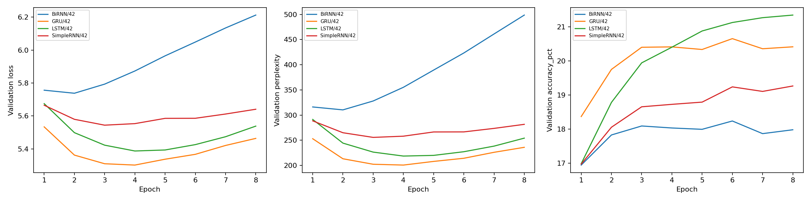
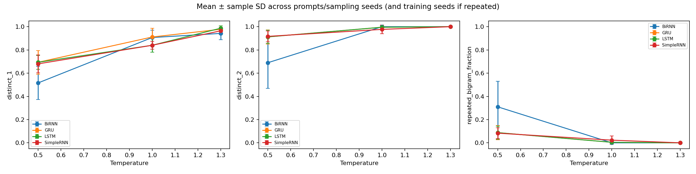

# Foundations of Generative AI (ICT4403)
## Assignment 2: Autoregressive Text Generation System

[](https://www.python.org/)
[](https://pytorch.org/)
[](https://huggingface.co/datasets/Salesforce/wikitext)

An empirical comparative study of word-level autoregressive language modeling that I developed using **Simple RNN**, **Bidirectional RNN**, **Long Short-Term Memory (LSTM)**, and **Gated Recurrent Unit (GRU)** on the WikiText-2 benchmark.

---

## Table of Contents
1. [Problem Statement and Objectives](#1-problem-statement-and-objectives)
2. [Dataset Description and Preprocessing](#2-dataset-description-and-preprocessing)
3. [Model Architectures](#3-model-architectures)
4. [Experimental Setup and Training Conditions](#4-experimental-setup-and-training-conditions)
5. [Execution Steps and Dependencies](#5-execution-steps-and-dependencies)
6. [My Quantitative Results](#6-my-quantitative-results)
7. [Comparative Model Evaluation](#7-comparative-model-evaluation)
8. [Sampling-Temperature Analysis](#8-sampling-temperature-analysis)
9. [Qualitative Text Generation Review](#9-qualitative-text-generation-review)
10. [Conclusion and Best-Performing Model](#10-conclusion-and-best-performing-model)
11. [Repository Structure](#11-repository-structure)

---

## 1. Problem Statement and Objectives

In this assignment, I formulate text generation as sequential autoregressive next-token prediction. By applying the chain rule of probability, I factorize the joint probability of a sequence of word tokens $\mathbf{w} = (w_1, w_2, \dots, w_T)$ into a product of conditional distributions:

$$P(w_1, w_2, \dots, w_T) = \prod_{t=1}^{T} P(w_t \mid w_{1:t-1})$$

Where $w_{1:t-1} = (w_1, \dots, w_{t-1})$ represents the historical prefix context available to the model at step $t$.

### My Core Objectives:
1. **Data Preprocessing & Causal Sequence Construction**: I construct an isolated, leak-free preprocessing pipeline on the WikiText-2 dataset, creating sliding-window input–target pairs $(X, y)$ where $X \in \mathbb{R}^{L}$ comprises $L = 30$ contiguous tokens and $y \in \mathbb{R}$ is the immediate next word token.
2. **Implementation of Recurrent Architectures**: I implement and train four distinct recurrent models—**Simple RNN (Elman)**, **Bidirectional RNN (BiRNN)**, **LSTM**, and **GRU**—under strictly controlled and comparable experimental conditions (identical embedding dimension, hidden dimension per direction, layers, learning rate, batch size, and seed).
3. **Multi-Faceted Evaluation**:
   - *Quantitative Metrics*: I measure cross-entropy loss, perplexity ($\text{PPL} = \exp(\text{Loss})$), next-token prediction accuracy (%), parameter counts, and CUDA-synchronized training execution time on held-out test data.
   - *Qualitative Characteristics*: I examine syntactic coherence, contextual consistency, lexical diversity, and repetition avoidance.
4. **Sampling-Temperature Investigation**: I generate text from identical seed sequences using temperature scaling ($T \in \{0.5, 1.0, 1.3\}$) across multiple sampling seeds, evaluate diversity metrics (Distinct-1, Distinct-2, Repeated-Bigram Fraction), and evaluate which architecture provides the most effective balance of perplexity, throughput, and generation quality on this corpus.

---

## 2. Dataset Description and Preprocessing

### Dataset Source
- **Dataset Name**: WikiText-2 (`wikitext-2-raw-v1`)
- **Source Link**: [Hugging Face Salesforce/wikitext](https://huggingface.co/datasets/Salesforce/wikitext)
- **Description**: I selected the WikiText-2 corpus because it is extracted from verified Good and Featured articles on Wikipedia, providing over 2 million raw tokens. Unlike the standard Penn Treebank (PTB), WikiText-2 preserves original punctuation, capitalization, and numbers, making it well-suited for realistic word-level language modeling.

### My Preprocessing Pipeline
1. **Split Isolation**: I maintain strict isolation between the official `train`, `validation`, and `test` splits to prevent data leakage.
2. **Paragraph Filtering**: I strip leading and trailing whitespace and remove entries with character length $\le 20$ characters. This effectively filters empty section headers and fragmented titles while retaining meaningful paragraphs.
3. **Tokenization**: I lowercase the text and apply regex-based tokenization to extract alphanumeric words and standard punctuation as separate tokens:
   ```python
   re.findall(r'\b\w+\b|[.,!?;]', text.lower())
   ```
4. **Vocabulary Construction**: I build the vocabulary exclusively from the training split. I retain the top 9,998 most frequent word tokens and reserve two special indices: `<pad>` at index 0 and `<unk>` at index 1, yielding a fixed vocabulary size of exactly $V = 10,000$.
5. **Autoregressive Window Construction**:
   - I concatenate tokenized words into a contiguous 1D stream per split.
   - I slide a window of length $L = 30$ tokens with a stride of $S = 3$ tokens.
   - Input: $X = [w_t, w_{t+1}, \dots, w_{t+29}]$
   - Target: $y = w_{t+30}$ (the immediate next token).
   - Training windows contain purely observed tokens without artificial padding, preventing recurrent states from learning uninformative pad symbols.

### Dataset Partitioning and Statistics
| Split | Raw Entries | Eligible Entries | Selected Entries | Total Tokens | Sequences ($L=30, S=3$) | Unknown Rate (%) |
| :--- | :---: | :---: | :---: | :---: | :---: | :---: |
| **Train** | 36,718 | 20,887 | 8,000 | 740,733 | 246,901 | 6.99% |
| **Validation** | 3,760 | 2,203 | 1,500 | 137,629 | 45,867 | 10.81% |
| **Test** | 4,358 | 4,358 | 4,358 (Full) | 228,714 | 76,228 | 11.65% |

---

## 3. Model Architectures

I designed a modular, unified PyTorch architecture where all models share an identical embedding layer and output projection head structure, allowing me to directly compare the recurrent mechanisms.

```
Input Tokens X [Batch, 30] 
       │
       ▼
Embedding Layer [10000 -> 256] + Dropout(0.2)
       │
       ▼
Recurrent Backbone (2 Layers, Hidden Dim 256 per direction)
 [SimpleRNN | BiRNN | LSTM | GRU]
       │
       ▼
Final Hidden State h_T [Batch, Hidden*Directions] + Dropout(0.2)
       │
       ▼
Output Linear Classifier [Hidden*Directions -> 10000]
       │
       ▼
Vocabulary Logits / Cross-Entropy Loss
```

### Mathematical Formulations

#### 1. Simple RNN (Elman RNN)
I implement the standard Elman recurrence where hidden state $h_t \in \mathbb{R}^{256}$ is updated as:
$$h_t = \tanh(W_{ih} x_t + b_{ih} + W_{hh} h_{t-1} + b_{hh})$$
- *Behavioral Profile*: Minimal computational overhead per step, but vulnerable to gradient vanishing across 30 time steps.
- *Parameters*: 5,393,168.

#### 2. Bidirectional RNN (BiRNN)
I implement a two-directional recurrent layer computing forward ($\overrightarrow{h}_t$) and backward ($\overleftarrow{h}_t$) hidden states:
$$\overrightarrow{h}_t = \tanh(\overrightarrow{W}_{ih} x_t + \overrightarrow{b}_{ih} + \overrightarrow{W}_{hh} \overrightarrow{h}_{t-1} + \overrightarrow{b}_{hh})$$
$$\overleftarrow{h}_t = \tanh(\overleftarrow{W}_{ih} x_t + \overleftarrow{b}_{ih} + \overleftarrow{W}_{hh} \overleftarrow{h}_{t+1} + \overleftarrow{b}_{hh})$$
I concatenate the final forward and backward states of the top layer: $h_{\text{final}} = [\overrightarrow{h}_T \,\|\, \overleftarrow{h}_1] \in \mathbb{R}^{512}$.
- *Architectural Explanation*: In this setup, both training windows and generation rollout process only the known prefix context (the target word is excluded from the input window). Therefore, BiRNN's backward direction processes only the observed past tokens in reverse order, which means it does not cause target leakage or an inherent train–inference mismatch. However, running recurrence backward over historical prefix tokens provides an alternative summary of past context rather than future conditioning.
- *Wider Output Head & Parameters*: Because concatenating forward and backward hidden states yields a 512-dimensional vector, BiRNN requires a wider output linear head (`nn.Linear(512, 10000)` instead of `nn.Linear(256, 10000)`). This projection layer alone accounts for 5,130,000 parameters (compared to 2,570,000 for unidirectional models), giving BiRNN 8,347,408 total parameters (the highest among all four models).

#### 3. Long Short-Term Memory (LSTM)
I implement the gated LSTM cell incorporating an internal cell state $C_t$ and three multiplicative gates (forget $f_t$, input $i_t$, and output $o_t$):
$$f_t = \sigma(W_f [h_{t-1}, x_t] + b_f)$$
$$i_t = \sigma(W_i [h_{t-1}, x_t] + b_i)$$
$$\widetilde{C}_t = \tanh(W_c [h_{t-1}, x_t] + b_c)$$
$$C_t = f_t \odot C_{t-1} + i_t \odot \widetilde{C}_t$$
$$o_t = \sigma(W_o [h_{t-1}, x_t] + b_o)$$
$$h_t = o_t \odot \tanh(C_t)$$
- *Behavioral Profile*: Gating mechanics and the linear cell update path ($C_t$) mitigate gradient vanishing across 30 time steps, at the expense of higher parameter count and longer training time per epoch.
- *Parameters*: 6,182,672.

#### 4. Gated Recurrent Unit (GRU)
Matching PyTorch's `nn.GRU` implementation, GRU computes reset ($r_t$), update ($z_t$), and new/candidate ($n_t$) gates without a separate cell state:
$$r_t = \sigma(W_{ir} x_t + b_{ir} + W_{hr} h_{t-1} + b_{hr})$$
$$z_t = \sigma(W_{iz} x_t + b_{iz} + W_{hz} h_{t-1} + b_{hz})$$
$$n_t = \tanh(W_{in} x_t + b_{in} + r_t \odot (W_{hn} h_{t-1} + b_{hn}))$$
$$h_t = (1 - z_t) \odot n_t + z_t \odot h_{t-1}$$
- *Behavioral Profile*: Retains gating benefits with fewer matrix projections (3 per unit vs 4 in LSTM), reducing memory footprint and accelerating training speed.
- *Parameters*: 5,919,504.

---

## 4. Experimental Setup and Training Conditions

I held hyperparameters and training procedures identical across all four models to ensure an unbiased, fair comparison:

| Hyperparameter / Setup | Value | Description |
| :--- | :--- | :--- |
| **Vocabulary Size ($V$)** | 10,000 | 9,998 frequent words + `<pad>` + `<unk>` |
| **Context Window ($L$)** | 30 tokens | Context window for next-token prediction |
| **Sliding Stride ($S$)** | 3 tokens | Sampling stride across concatenated token stream |
| **Embedding Dimension** | 256 | Dense semantic vector representation |
| **Hidden Dimension** | 256 | Per direction (BiRNN has $2 \times 256 = 512$ concatenated) |
| **Recurrent Layers** | 2 | Stacked hierarchical recurrent depth |
| **Dropout Rate** | 0.2 | Applied to embeddings and between recurrent layers |
| **Optimizer** | Adam ($\beta_1=0.9, \beta_2=0.999$) | Adaptive learning rate optimization |
| **Learning Rate** | 0.001 | Constant schedule across 8 epochs |
| **Batch Size** | 128 | Partial batches retained without dropping |
| **Gradient Clipping** | 1.0 (Max Norm) | Suppresses gradient explosion during backpropagation |
| **Training Epochs** | 8 | Sufficient to identify best validation epoch and observe overfitting |
| **Training Seed** | 42 | Controls batch order and weight initialization (single seed) |
| **Checkpoint Criterion** | Minimum Validation Loss | Test metrics evaluated strictly on restored best weights |
| **Hardware Environment** | NVIDIA Tesla T4 GPU | CUDA 12.8, cuBLAS workspace `:4096:8` |

*Methodological Note:* A single training seed (seed 42) is used as a standardized benchmark run. It controls batch ordering and initialization, but cannot establish statistical significance or prove ranking stability across multiple training runs.

---

## 5. Execution Steps and Dependencies

### Prerequisites
- Python 3.10+
- PyTorch 2.0+ (CUDA GPU recommended)

### Installation
Clone my repository and install dependencies:
```bash
git clone https://github.com/Elton1025/FGAI.git
cd FGAI
pip install -r requirements.txt
```

### Reproducing My Results

#### Option A: Running My Standalone Script
To regenerate my summary tables, diversity metrics, and plots from existing run logs:
```bash
python train_and_evaluate.py --action export --output .
```
To run full end-to-end training and evaluation from scratch:
```bash
python train_and_evaluate.py --action train --output results/
```

#### Option B: Executing the Jupyter Notebook
Open and run `autoregressive_text_generation.ipynb` in Jupyter Lab, VS Code, or Google Colab / Kaggle.

---

## 6. My Quantitative Results

I evaluated all four models on the held-out test split (76,228 sequences, 228,714 tokens) using each model's best checkpoint selected strictly by minimum validation loss.

### Benchmark Results Table
| Model | Parameters | Best Epoch | Final Train Loss | Best Val Loss | Best Val PPL | Final Val PPL | Test Loss | Test Perplexity (PPL) | Test Accuracy (%) | Pure Train Time | Total Fit Time |
| :--- | :---: | :---: | :---: | :---: | :---: | :---: | :---: | :---: | :---: | :---: | :---: |
| **SimpleRNN** | 5,393,168 | 3 | 4.8068 | 5.5442 | 255.76 | 281.69 | 5.4981 | **244.23** | 18.59% | **140.87s** | 149.65s |
| **BiRNN** | 8,347,408 | 2 | 4.2969 | 5.7379 | 310.41 | 498.71 | 5.6882 | **295.36** | 17.68% | 242.03s | 257.01s |
| **LSTM** | 6,182,672 | 4 | 4.6127 | 5.3876 | 218.68 | 254.28 | 5.3597 | **212.66** | **20.05%** | 228.23s | 241.39s |
| **GRU** | 5,919,504 | 4 | 4.1832 | 5.3022 | 200.78 | 236.04 | 5.2723 | **194.87** | 19.97% | **195.74s** | 207.15s |

*Note: Perplexity is defined as $\text{PPL} = \exp(\text{Loss})$. Checkpoints were selected strictly on validation loss to prevent test data leakage. Pure Train Time isolates training batch transfers and optimization from validation passes and checkpoint writes.*

### Validation Learning Curves
The curves below track validation loss, perplexity, and top-1 accuracy throughout the 8 training epochs:



### Key Quantitative Findings:
1. **Perplexity Results**: **My GRU model achieved the lowest test perplexity of 194.87** and lowest test loss of 5.2723. LSTM achieved the second-lowest test perplexity (212.66), SimpleRNN achieved 244.23, and BiRNN achieved the highest at 295.36.
2. **Prediction Accuracy**: LSTM achieved the highest test accuracy (20.05%), closely followed by GRU (19.97%), SimpleRNN (18.59%), and BiRNN (17.68%).
3. **Computational Throughput**: SimpleRNN was the fastest per epoch (total pure training time 140.87s). Among gated models, GRU completed training in 195.74s—**14.2% faster than LSTM (228.23s)** and **19.1% faster than BiRNN (242.03s)**.
4. **Validation Loss Deterioration across All Models**:
   - Every single model began overfitting after its best validation epoch:
     - SimpleRNN reached its validation minimum at Epoch 3 (Val Loss 5.5442, Val PPL 255.76) and deteriorated to 5.6408 (Val PPL 281.69) by Epoch 8.
     - BiRNN reached its validation minimum at Epoch 2 (Val Loss 5.7379, Val PPL 310.41) and deteriorated sharply to 6.2120 (Val PPL 498.71) by Epoch 8, while training loss fell to 4.2969.
     - LSTM reached its validation minimum at Epoch 4 (Val Loss 5.3876, Val PPL 218.68) and deteriorated to 5.5385 (Val PPL 254.28) by Epoch 8.
     - GRU reached its validation minimum at Epoch 4 (Val Loss 5.3022, Val PPL 200.78) and deteriorated to 5.4640 (Val PPL 236.04) by Epoch 8.

---

## 7. Comparative Model Evaluation

```
                    Model Trade-off Landscape
    Perplexity (Lower is Better) vs Training Time (Seconds)
  ┌─────────────────────────────────────────────────────────┐
  │ 300 ┼                        BiRNN (295.36 PPL, 242s)   │
  │     │                                                   │
  │ 250 ┼      SimpleRNN (244.23 PPL, 141s)                 │
  │     │                                                   │
  │ 200 ┼                           LSTM (212.66 PPL, 228s) │
  │     │                   ★ GRU (194.87 PPL, 196s)        │
  │     └──────┬────────────────────┬───────────────────────┤
  │           140s                 200s                    250s
  └─────────────────────────────────────────────────────────┘
```

### Architectural Analysis:
- **GRU vs LSTM**: In this run, GRU achieved lower test perplexity (194.87 vs 212.66) and lower test loss (5.2723 vs 5.3597) while training faster (195.74s vs 228.23s). LSTM achieved slightly higher top-1 test accuracy (20.05% vs 19.97%). Both models showed similar validation trajectory shapes, peaking at Epoch 4 before overfitting.
- **BiRNN Performance**: BiRNN achieved the highest test perplexity (295.36) and lowest test accuracy (17.68%). Both training and generation process only known context, so the backward direction does not inherently cause target leakage or a train–inference mismatch. However, running recurrence backward over historical prefix tokens provides an alternative summary of past context rather than future conditioning. Combined with its wider output projection head (512 inputs vs 256 for unidirectional models, giving it 8.35M parameters), BiRNN overfitted earliest (Epoch 2) and exhibited pronounced degenerate looping at low temperature.
- **SimpleRNN Performance**: While SimpleRNN was the fastest per epoch (140.87s total), it achieved higher perplexity (244.23) and lower accuracy (18.59%) than the gated models, and peaked early at Epoch 3.

---

## 8. Sampling-Temperature Analysis

I conducted sequential text generation using temperature-scaled multinomial sampling across three distinct operational regimes:
$$P(w_i) = \frac{\exp(z_i / T)}{\sum_{j=1}^{V} \exp(z_j / T)}$$

Where $z_i$ is the unnormalized logit for token $i$, and $T > 0$ is the sampling temperature. Special tokens (`<pad>` and `<unk>`) were masked with $-\infty$ during generation to prevent uninformative degenerate symbols from being sampled. Note that masking special tokens alters the sampling distribution relative to unmasked test evaluation.

### Diversity Metrics across Temperatures
I computed Distinct-1 (unigram Type-Token Ratio), Distinct-2 (unique bigram ratio), and Repeated-Bigram Fraction over 108 continuations (3 prompts $\times$ 3 temperatures $\times$ 3 seeds $\times$ 4 models). Note that Distinct-2 and repeated-bigram fraction are arithmetic complements ($1 - \text{Distinct-2}$), not independent evidence. Standard deviations reflect descriptive sample variation across prompts and sampling seeds, not independent training uncertainty.

| Model | Temperature ($T$) | Distinct-1 (TTR) | Distinct-2 | Repeated-Bigram Fraction | Observed Behavioral Profile |
| :--- | :---: | :---: | :---: | :---: | :--- |
| **SimpleRNN** | 0.5 | 0.680 ± 0.077 | 0.917 ± 0.047 | 0.083 ± 0.047 | Locally plausible segments, repetitive determiners, topic drift |
| **SimpleRNN** | 1.0 | 0.840 ± 0.035 | 0.977 ± 0.037 | 0.023 ± 0.037 | Higher lexical variety, frequent topic shifts, grammatical errors |
| **SimpleRNN** | 1.3 | 0.964 ± 0.031 | 1.000 ± 0.000 | 0.000 ± 0.000 | High vocabulary diversity, severe loss of syntactic cohesion |
| **BiRNN** | 0.5 | 0.516 ± 0.142 | 0.690 ± 0.221 | **0.310 ± 0.221** | **Severe degenerate looping (individual sample max 58.33% repeated)** |
| **BiRNN** | 1.0 | 0.907 ± 0.063 | 1.000 ± 0.000 | 0.000 ± 0.000 | Moderate local fluency, abrupt thematic jumps |
| **BiRNN** | 1.3 | 0.942 ± 0.053 | 1.000 ± 0.000 | 0.000 ± 0.000 | Fragmented grammar, random entity combinations |
| **LSTM** | 0.5 | 0.693 ± 0.060 | 0.912 ± 0.057 | 0.088 ± 0.057 | Locally structured phrases, repetitive function words |
| **LSTM** | 1.0 | 0.840 ± 0.060 | 0.995 ± 0.014 | 0.005 ± 0.014 | Good variety of words, locally plausible transitions, topic drift |
| **LSTM** | 1.3 | 0.987 ± 0.020 | 1.000 ± 0.000 | 0.000 ± 0.000 | High lexical diversity, disjoint phrasing, low cohesion |
| **GRU** | 0.5 | 0.693 ± 0.102 | 0.912 ± 0.061 | 0.088 ± 0.061 | Relevant topical vocabulary, local repetition of key phrases |
| **GRU** | 1.0 | 0.911 ± 0.074 | 0.995 ± 0.014 | 0.005 ± 0.014 | Diverse vocabulary, locally plausible phrases, occasional topic drift |
| **GRU** | 1.3 | 0.978 ± 0.029 | 1.000 ± 0.000 | 0.000 ± 0.000 | High lexical diversity, fragmented grammar |



---

## 9. Qualitative Text Generation Review

I audited generated continuations across three representative seed prompts. Across all models, generated text exhibits locally plausible phrases and occasional relevant vocabulary, but also frequent grammatical errors, topic drift, and repetition. None of the models demonstrated sustained long-range coherence across the 25-token budget.

### Seed Prompt 1: `"the history of the united states began with"`
- **My GRU model ($T=0.5$)**: `... the arrival of the bombardment . the palace was unsuccessful by the germans to the antarctic . the first half of the japanese , the`
  - *My Assessment*: Produces some historically plausible vocabulary ("arrival", "bombardment", "germans", "japanese") and local grammatical structure, but mixes unrelated geographic and temporal references, failing to sustain an accurate historical narrative.
- **My BiRNN model ($T=0.5$)**: `... the end of the united states . the storm was built on the basis of the season , but he was built to be the`
  - *My Assessment*: Echoes tokens from the prompt prefix ("united states") and re-uses repetitive phrasing templates ("built on the basis", "built to be").
- **My LSTM model ($T=1.0$)**: `... the names in the north sea and end of the state of the country . wasp . the first family , is christmas , or`
  - *My Assessment*: Shows lexical variety, but suffers from abrupt punctuation breaks ("wasp .") and disjoint semantic transitions.
- **My SimpleRNN model ($T=1.3$)**: `... conscientious names in the spring . while end proposed c4 aggressive loan has it probability antarctic . esarhaddon km2 in cedar is christmas , security`
  - *My Assessment*: High unigram diversity (Distinct-1: 0.92) accompanied by severe breakdown of grammatical structure and meaning ("esarhaddon km2 in cedar").

### Seed Prompt 2: `"during the second world war the army was"`
- **My BiRNN model ($T=0.5$) — Degenerate Looping Failure Mode**:
  ```
  ... an honorary on the end of the end of the end of the end of the west end of the end of the victims .
  ```
  - *My Assessment*: BiRNN suffers from severe mode collapse at low temperature. In sample `BiRNN-train42-p2-t0.5-s202`, the phrase "of the end" loops repeatedly, driving the repeated-bigram fraction to a study-high of **58.33%** (Distinct-1 drops to 0.44). In sample `s101`, it repeats "of the end" 5 times consecutively (54.17% repeated bigrams).
- **My GRU model ($T=0.5$)**: `... officially built in the united kingdom . the proposed of the album has been recorded in the united states , which is the most of`
  - *My Assessment*: Begins with a locally plausible phrase ("officially built in the united kingdom"), but immediately drifts from the military context of World War II into Wikipedia music album terminology.
- **My LSTM model ($T=1.0$)**: `... loved a in 1895 until the base end , such as a 2 to take two . the first family , this christmas , the`
  - *My Assessment*: Generates historical year tokens ("1895") and avoids repetitive loops, but produces ungrammatical sentence transitions ("loved a in 1895 until the base end").

### Seed Prompt 3: `"the album received positive reviews from music critics"`
- **My GRU model ($T=0.5$) — Domain Vocabulary with Local Repetition**:
  ```
  ... . it incorporates the billboard best selling episode , carey performed crazy in love love s . crazy in love , you christmas , you
  ```
  - *My Assessment*: My GRU model generates several domain-relevant tokens present in the training corpus ("billboard", "carey", "crazy in love"), showing topical alignment. However, it also suffers from repetition ("crazy in love love s . crazy in love") and fails to maintain a clean sentence structure.
- **My LSTM model ($T=0.5$)**: `... . the ship was certified fitted to the stem of the album s season . the same year , the first is the first power`
  - *My Assessment*: Retains the prompt-related word ("album"), but mixes nautical terminology ("ship was certified fitted") with album text, showing topic drift.
- **My SimpleRNN model ($T=0.5$)**: `... . the song was released in the end of the state of the 3rd government . . the first down , he was established on`
  - *My Assessment*: Initially associates "album" with "song was released", but quickly shifts into governmental vocabulary.

---

## 10. Conclusion and Best-Performing Model

### Final Model Comparison

| Evaluation Dimension | Rank 1 (Best) | Rank 2 | Rank 3 | Rank 4 (Worst) | Summary of Trade-offs |
| :--- | :---: | :---: | :---: | :---: | :--- |
| **Test Perplexity (Lower is Better)** | **GRU (194.87)** | LSTM (212.66) | SimpleRNN (244.23) | BiRNN (295.36) | GRU achieved the lowest test cross-entropy loss (5.2723) |
| **Test Accuracy (%)** | **LSTM (20.05%)** | GRU (19.97%) | SimpleRNN (18.59%) | BiRNN (17.68%) | LSTM had marginally higher top-1 accuracy |
| **Pure Training Time** | **SimpleRNN (141s)** | **GRU (196s)** | LSTM (228s) | BiRNN (242s) | GRU was 14.2% faster than LSTM |
| **Parameter Footprint** | **SimpleRNN (5.39M)** | **GRU (5.92M)** | LSTM (6.18M) | BiRNN (8.35M) | BiRNN's wider output head added 2.56M parameters |
| **Low-T Generation Stability** | **LSTM & GRU** | SimpleRNN | — | BiRNN | BiRNN suffered severe repetitive looping at T=0.5 (up to 58.33%) |
| **Sustained Coherence** | None | None | None | None | All four models exhibit weak sustained coherence across 25 tokens |

### Overall Choice Justification: **Gated Recurrent Unit (GRU)**
Based on the empirical evidence of this run:
1. **Lowest Test Perplexity**: GRU achieved the lowest test perplexity of **194.87** (test loss 5.2723), compared to LSTM's 212.66, SimpleRNN's 244.23, and BiRNN's 295.36.
2. **Computational Speed**: GRU completed pure training in **195.74s**, which is **14.2% faster than LSTM (228.23s)** and **19.1% faster than BiRNN (242.03s)**.
3. **Trade-offs Acknowledged**: While LSTM achieved slightly higher test accuracy (20.05% vs 19.97%), GRU offers the best combination of low perplexity and training throughput. However, all models exhibited weak sustained coherence in qualitative generation, with samples displaying local phrasing, topic drift, grammatical errors, and vulnerability to repetition.

---

## 11. Repository Structure

```
.
├── autoregressive_text_generation.ipynb   # Complete interactive notebook with code, outputs & markdown
├── notebook94b14f6649.ipynb               # Original Kaggle experiment execution notebook
├── train_and_evaluate.py                  # Standalone modular Python pipeline (CLI support)
├── requirements.txt                       # Python dependencies
├── config.json                            # Experimental hyperparameters
├── environment.json                       # Execution runtime & GPU specifications
├── dataset_statistics.json                # Preprocessing and vocabulary split statistics
├── vocabulary.json                        # Full 10,000-token vocabulary mapping
├── results.csv                            # Final quantitative metrics across all four models
├── history.csv                            # Epoch-by-epoch training/validation progression
├── history.json                           # Raw per-epoch metrics logs
├── SimpleRNN-seed42-history.json           # SimpleRNN training history log
├── BiRNN-seed42-history.json              # BiRNN training history log
├── LSTM-seed42-history.json               # LSTM training history log
├── GRU-seed42-history.json                # GRU training history log
├── samples.csv                            # 108 generated continuations across models & temperatures
├── temperature_summary.csv                # Aggregate diversity metrics (Distinct-1, Distinct-2, Repetition)
├── learning_curves.png                    # Validation loss, perplexity, and accuracy curves
├── temperature_metrics.png                # Diversity metrics vs sampling temperature plot
├── .gitignore                             # Ignored checkpoints, reports, and environment artifacts
└── README.md                              # Project documentation
```

---

## Author & Course Information
- **Course**: Foundations of Generative AI (ICT4403)
- **Assignment**: Assignment 2 — Autoregressive Text Generation
- **Author**: Elton Lewis
- **Dataset**: [WikiText-2 (Salesforce/wikitext)](https://huggingface.co/datasets/Salesforce/wikitext)
